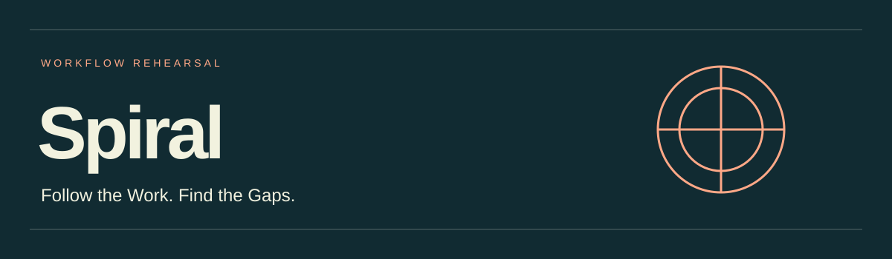

# Detailed Project Reference

[Return to the project overview](README.md). Setup, research and supporting detail are retained below.

[Installation and updates](INSTALL.md) · [Synthetic validation](validation/README.md).
The initial fixture walkthrough is an unblinded consistency review. A subsequent
[separate-agent blinded evaluation](validation/blind-2026-10-24/RESULTS.md) covers
the synthetic fixtures; repeated isolated trials and real application testing remain outstanding.

# Spiral

Draft agent skill for pre-build rehearsal of multi-person, asynchronous workflows. For product managers, designers and engineers who need to specify handoffs before implementation.

Use [spiral-workflow-rehearsal](skills/spiral-workflow-rehearsal/SKILL.md) with role permissions, workflow specs, mockups, notification templates and timing rules. Supply whichever artifacts exist; missing evidence becomes an explicit uncertainty.

Example invocation: `$spiral-workflow-rehearsal Rehearse this approval workflow from each actor's visible information. Trace missed notifications, reassignment and late approvals; return source-linked handoff requirements and acceptance scenarios.`

Spiral tracks what each actor can see, knows, must do and is waiting for. It complements Longshot's rendered interface testing and Dazzler's creation work; neither is required. It does not simulate human behavior, predict adoption or perform live multi-user testing.

Bounded uses include revision-sensitive approvals, collaborative publication, service handoffs, support shifts and marketplace acceptance/expiry coordination. [Research foundations and limits](skills/spiral-workflow-rehearsal/references/research.md) connect the review to distributed cognition, common ground, asynchronous awareness, coordination dependencies and workflow exceptions. [Conditional cases](skills/spiral-workflow-rehearsal/references/conditional-cases.md) extend the fictional example and outline proposed synthetic validation. Research informs the method; it does not prove correctness or human efficacy.

The [fictional worked example](skills/spiral-workflow-rehearsal/references/fictional-approval.md) illustrates the output. This package has received structural checks, an [unblinded synthetic walkthrough](validation/REVIEW-2026-10-24.md) and one [separate-agent blinded evaluation](validation/blind-2026-10-24/RESULTS.md). Real application testing and human efficacy validation remain outstanding. Findings are logical deductions or hypotheses bounded by the supplied sources. No market-first or trademark-clearance claim is made.

## Landing Page Source

[Preview source](docs/index.html) · [Design notes](docs/DESIGN.md). The responsive static page is published through GitHub Pages at https://jongos.github.io/Spiral/. To preview a local checkout with Python available, run `python -m http.server 8000 --bind 127.0.0.1 --directory docs` and open `http://127.0.0.1:8000`. No installation is needed for the site itself.

The page uses original vector illustrations and locally bundled Inter and League Gothic fonts, with their notices in `docs/fonts/`. GitHub Pages publishes the docs directory from main. Repository visibility remains unchanged.

[Desktop preview](docs/previews/desktop.jpg) · [Mobile preview](docs/previews/mobile.jpg) · [Validation scope](docs/VALIDATION.md)
